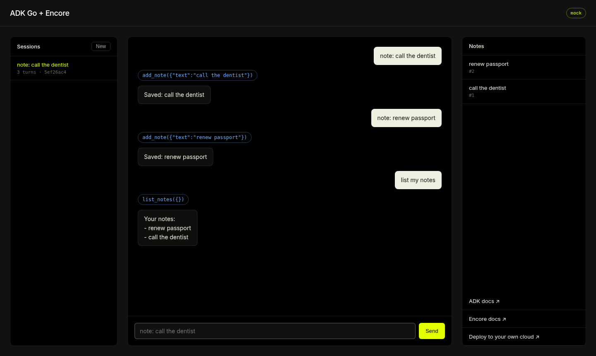

# ADK Go + Encore

A [Google ADK Go](https://github.com/google/adk-go) agent running as an [Encore](https://encore.dev/docs/go) service. You declare the database, Pub/Sub topic and cron job in Go code, and Encore runs them locally and provisions them in your own cloud.



- `agent`: ADK `llmagent` with a `runner.Runner`. Sessions use ADK's `session/database` store on an Encore Postgres database. It exposes chat (JSON and SSE streaming), session list and history endpoints. A Pub/Sub topic `turn-completed` feeds a subscriber that counts session turns, and a daily cron job deletes sessions idle for 30 days.
- `notes`: a typed Encore API with its own database. Notes belong to the authenticated user. The agent calls it through two ADK function tools, `add_note` and `list_notes`.
- `auth`: an [auth handler](https://encore.dev/docs/go/develop/auth) that checks bearer API keys.
- `site`: the demo page at `/`.

## Run locally

Requires [Encore](https://encore.dev/docs/go/install), Go and Docker.

```bash
encore app create my-agent --example=adk-agent
cd my-agent
encore secret set --type dev,local APIKeys
encore run
```

`APIKeys` is a JSON object mapping user IDs to keys, for example `{"alice":"<random key>"}`. Generate keys with `openssl rand -hex 32`. For deployed environments set it with `encore secret set --type prod,preview APIKeys`.

Open http://localhost:4000 and enter your key when asked. The page keeps it in localStorage. Without a model key the agent uses a built-in mock model, so everything except the LLM call runs offline.

To use Gemini, set a [Gemini API key](https://aistudio.google.com/apikey):

```bash
encore secret set --type dev,preview,local GoogleAPIKey
```

`GOOGLE_API_KEY` in the environment also works. `GEMINI_MODEL` overrides the model (default `gemini-flash-latest`).

## API

```bash
KEY=<your key>
curl -X POST localhost:4000/agent/chat -H "Authorization: Bearer $KEY" -d '{"message":"note: call the dentist"}'
curl -N -X POST localhost:4000/agent/chat/stream -H "Authorization: Bearer $KEY" -d '{"message":"list my notes"}'
curl -H "Authorization: Bearer $KEY" localhost:4000/agent/sessions
curl -H "Authorization: Bearer $KEY" localhost:4000/agent/sessions/<id>
curl -H "Authorization: Bearer $KEY" localhost:4000/notes
```

Every endpoint except `/agent/status` and the page requires a key. The user ID comes from the key and owns the ADK sessions and notes, and the agent's tools call the notes service as that user. A turn times out after 60 seconds, each user can run one turn at a time and 10 turns a minute, each user can keep 50 sessions and 100 notes of up to 1000 characters, and note writes are limited to 10 a minute. The turn and write limits are kept in memory, so they apply per instance. For real users, replace the static keys with your identity provider in the auth handler.

## Sessions in Postgres

ADK's [`session/database`](https://pkg.go.dev/google.golang.org/adk/v2/session/database) store takes a GORM dialector, so it is pointed at the Encore database with `postgres.New(postgres.Config{Conn: db.Stdlib()})`. The service connects with a role that can't create tables, so `database.AutoMigrate` fails at runtime. The tables go in a migration instead, [`agent/migrations/1_adk_sessions.up.sql`](agent/migrations/1_adk_sessions.up.sql), which Encore applies before the service starts. Regenerate the migration when upgrading ADK.

## Deploy

- [Deploy to your own cloud ↗](https://encore.dev/docs/platform/deploy/own-cloud)
- [Self-hosting with Docker ↗](https://encore.dev/docs/go/self-host/docker-build)

## Docs

- [ADK ↗](https://google.github.io/adk-docs/)
- [adk-go ↗](https://pkg.go.dev/google.golang.org/adk/v2)
- [Encore Go ↗](https://encore.dev/docs/go)
